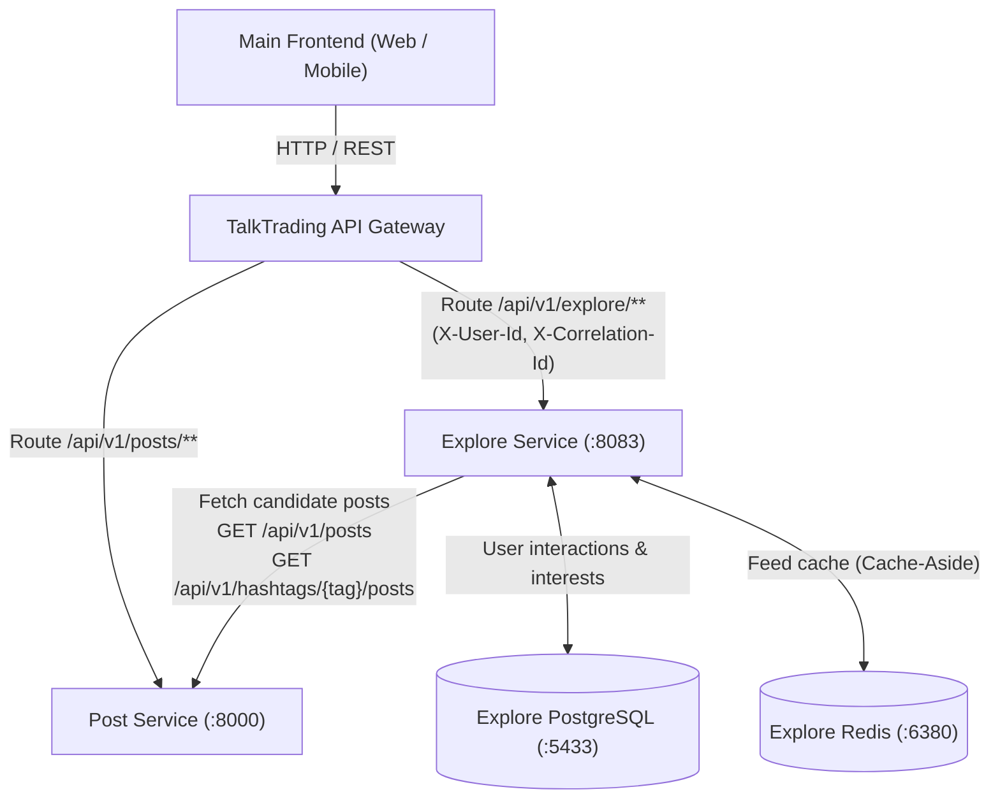

# TalkTrading Explore Service — Integration Guide

## 1. Purpose

The **Explore Service** is an independently deployable microservice within the TalkTrading social trading platform. It is responsible for content discovery, feed ranking, user personalization, and hashtag exploration.

### Key Responsibilities:
- **Personalized Content Discovery:** Generating a tailored feed for users based on historical interaction signals and affinities.
- **Trending Feeds:** Scoring posts by real-time engagement velocity and recency.
- **Popular Feeds:** Highlighting all-time high-engagement discussions across the platform.
- **Recent Feeds:** Delivering reverse-chronological content with subtle quality tie-breakers.
- **Hashtag Feeds:** Serving ranked posts tagged with specific asset classes, tickers, or topics (e.g. `#bitcoin`, `#forex`).
- **Deterministic Ranking Engine:** Applying multi-factor mathematical scoring across interaction metrics.
- **Interest & Affinity Tracking:** Persisting user-level topic weights and tracking recently seen content.
- **Low-Latency Caching:** Providing Redis cache-aside resolution with local mutex stampede protection.

> [!IMPORTANT]
> **POST DATA IS STRICTLY OWNED BY POST SERVICE.**
> Explore Service **DOES NOT** become the source of truth for posts, captions, media attachments, comments, or author profiles. Explore Service consumes candidate post records from Post Service, evaluates and personalizes them, and returns ranked discovery feeds. It maintains its own decoupled data store solely for user interests, interaction histories, and ranking baselines.

---

## 2. How It Fits Into TalkTrading

Explore Service operates as an internal backend microservice positioned strictly behind the TalkTrading API Gateway.



### Component Responsibilities:
- **Main Frontend:** Client interface consuming discovery feeds and dispatching user interaction telemetry.
- **API Gateway:** The single public ingress point. Authenticates users, validates session JWTs, enforces CORS, scrubs untrusted caller headers, injects trusted `X-User-Id` and `X-Correlation-Id` headers, and routes `/api/v1/explore/**` downstream.
- **Post Service:** Canonical source of truth for authoring, editing, storing, and serving posts, comments, media, and hashtags.
- **Explore Service:** Consumes candidate posts from Post Service, filters out seen/irrelevant items, calculates deterministic and personalized scores, and caches results in Redis.
- **Explore PostgreSQL:** Stores user topic interest weights (`user_interests`), interaction history (`user_interactions`), and dynamic ranking baselines (`explore_ranking_config`). Completely separate from Post Service DB.
- **Explore Redis:** Key-value cache storing ranked JSON response payloads with jittered TTLs to minimize downstream load.

---

## 3. Repository Structure

Actual directory layout of this repository:

```text
explore/
├── .dockerignore
├── .gitignore
├── Dockerfile                                 # Multi-stage Java 23 container build with liveness health check
├── docker-compose.yml                         # Local orchestration for Explore, Postgres, Redis, and Frontend
├── pom.xml                                    # Maven project descriptor (Spring Boot 3.4.3, Java 23)
├── README.md                                  # This integration guide
├── frontend/                                  # Isolated development and reference UI
│   ├── .dockerignore
│   ├── Dockerfile                             # Node 20 runtime for frontend dev server
│   ├── index.html                             # UI entrypoint
│   ├── package.json                           # React 18 + Vite 5 dependencies
│   ├── serve.py                               # Zero-dependency Python proxy & preview server
│   ├── vite.config.js                         # Vite dev server with proxy to backend (:8083)
│   └── src/
│       ├── App.jsx                            # Explore page, tabs, debug panel, interaction triggers
│       ├── index.css                          # Dark-mode fintech styling system
│       └── main.jsx                           # React root mounting
└── src/
    ├── main/
    │   ├── java/com/talktrading/explore/
    │   │   ├── ExploreServiceApplication.java # Spring Boot main entrypoint
    │   │   ├── client/
    │   │   │   ├── PostServiceClient.java     # RestClient for downstream Post Service with Resilience4j
    │   │   │   └── dto/
    │   │   │       ├── ExternalMediaDto.java  # Media attachment model from Post Service
    │   │   │       ├── ExternalPostDto.java   # Post candidate model from Post Service
    │   │   │       └── HashtagPostsResponseDto.java # Hashtag candidate response from Post Service
    │   │   ├── config/
    │   │   │   ├── CorrelationIdFilter.java   # MDC correlation ID filter (X-Correlation-Id)
    │   │   │   ├── OpenApiConfig.java         # Swagger / OpenAPI documentation beans
    │   │   │   ├── PostServiceHealthIndicator.java # Spring Actuator health contributor for Post Service
    │   │   │   ├── RedisConfig.java           # RedisTemplate with JSON serializers
    │   │   │   ├── RestClientConfig.java      # HTTP client timeouts & builder
    │   │   │   └── SecurityUtils.java         # Gateway caller identity resolution (X-User-Id)
    │   │   ├── controller/
    │   │   │   └── ExploreController.java     # REST controllers for all /api/v1/explore endpoints
    │   │   ├── dto/
    │   │   │   ├── ErrorResponse.java         # Standardized error payload
    │   │   │   ├── ExplorePostDto.java        # Ranked post item returned to client
    │   │   │   ├── ExploreResponse.java       # Paginated feed response wrapper
    │   │   │   └── UserInteractionRequest.java# Payload for POST /interactions
    │   │   ├── entity/
    │   │   │   ├── InteractionType.java       # Enum: VIEW, CLICK, LIKE, COMMENT, SHARE, DISMISS
    │   │   │   ├── UserInteraction.java       # JPA entity: audit record of user interactions
    │   │   │   └── UserInterest.java          # JPA entity: topic affinity weights per user
    │   │   ├── exception/
    │   │   │   ├── DownstreamServiceException.java
    │   │   │   ├── GlobalExceptionHandler.java# Centralized ControllerAdvice for RFC-compliant errors
    │   │   │   ├── InvalidParameterException.java
    │   │   │   └── ResourceNotFoundException.java
    │   │   ├── repository/
    │   │   │   ├── UserInteractionRepository.java
    │   │   │   └── UserInterestRepository.java
    │   │   └── service/
    │   │       ├── ExploreService.java        # Feed generation, pagination, Redis cache-aside, mutex locking
    │   │       ├── PostScorer.java            # Strategy interface for candidate post scoring
    │   │       ├── RankingService.java        # Weighted multi-factor algorithm implementation
    │   │       └── RecommendationService.java # Affinity boosts, interaction recording, seen-post filter
    │   └── resources/
    │       ├── application.yml                # Configuration defaults, Redis, Flyway, Resilience4j settings
    │       └── db/migration/
    │           └── V1__init_explore_schema.sql# Flyway migration creating tables & initial ranking seeds
    └── test/
        ├── java/com/talktrading/explore/
        │   ├── ExploreServiceApplicationTests.java
        │   ├── client/PostServiceClientTest.java
        │   ├── config/CorrelationIdFilterTest.java
        │   ├── config/SecurityUtilsTest.java
        │   ├── config/TestRedisConfig.java
        │   ├── controller/ExploreControllerTest.java
        │   ├── exception/GlobalExceptionHandlerTest.java
        │   └── service/
        │       ├── ExploreServiceTest.java
        │       ├── RankingServiceTest.java
        │       └── RecommendationServiceTest.java
        └── resources/
            └── application-test.yml           # H2 in-memory test profile configuration
```

---

## 4. Technology Stack

Actual versions defined in [`pom.xml`](file:///c:/Users/wizar/Desktop/explore/pom.xml), [`Dockerfile`](file:///c:/Users/wizar/Desktop/explore/Dockerfile), and [`frontend/package.json`](file:///c:/Users/wizar/Desktop/explore/frontend/package.json):

| Layer / Tool | Technology / Dependency | Version | Notes |
|---|---|---|---|
| **Runtime & Language** | Java (JDK) | `23` | Eclipse Temurin 23 (`XX:+UseZGC`) |
| **Framework** | Spring Boot | `3.4.3` | Parent starter |
| **Build Tool** | Apache Maven | `3.9.9` | Maven compiler target 23 |
| **Relational Database** | PostgreSQL | `16-alpine` | Port 5432 internally / 5433 host |
| **Database Migrations**| Flyway Core + Flyway PostgreSQL | `10.x` (Spring Boot 3.4 managed) | Schema versioning (`V1__init_explore_schema.sql`) |
| **Cache & In-Memory Store** | Redis | `7-alpine` | Port 6379 internally / 6380 host |
| **Circuit Breaker** | Resilience4j Spring Boot 3 | `2.2.0` | Circuit breaker + exponential retry |
| **API Docs** | SpringDoc OpenAPI Starter WebMVC | `2.8.5` | Swagger UI at `/swagger-ui.html` |
| **Metrics** | Micrometer Prometheus Registry | Managed | Actuator metrics at `/actuator/prometheus` |
| **Container Engine** | Docker & Docker Compose | Docker Compose v2 | Multi-stage builder & non-root user |
| **Reference Frontend** | React + Vite | React `18.3.1`, Vite `5.4.x` | Vanilla CSS, Zero external UI bloat |

---

## 5. Running Explore Locally

### Docker Compose Stack
From the project root:

```bash
# 1. Build and start all services in background
docker compose up --build -d

# 2. Inspect running services and health status
docker compose ps
```

### Published Host Ports:
- **Explore Service:** `http://localhost:8083`
- **PostgreSQL Database:** `localhost:5433` (`explore_db`, user: `postgres`, pass: `postgres`)
- **Redis Cache:** `localhost:6380`
- **Frontend Reference UI:** `http://localhost:3000`

### Expected Container Status:
```text
NAME                           SERVICE            STATUS                   PORTS
talktrading-explore-service    explore-service    Up (healthy)             0.0.0.0:8083->8083/tcp
talktrading-explore-postgres   explore-postgres   Up (healthy)             0.0.0.0:5433->5432/tcp
talktrading-explore-redis      explore-redis      Up (healthy)             0.0.0.0:6380->6379/tcp
talktrading-explore-frontend   explore-frontend   Up                       0.0.0.0:3000->3000/tcp
```

### Inspecting Logs:
```bash
# Explore Service application logs
docker compose logs -f --tail=100 explore-service

# PostgreSQL logs
docker compose logs -f --tail=50 explore-postgres

# Redis logs
docker compose logs -f --tail=50 explore-redis

# Frontend logs
docker compose logs -f --tail=50 explore-frontend
```

### Stopping the Stack:
```bash
# Stop containers without destroying persistent volumes
docker compose down

# Stop and wipe persistent volume data (clean reset)
docker compose down -v
```

---

## 6. Environment Configuration

All properties are declared in [`src/main/resources/application.yml`](file:///c:/Users/wizar/Desktop/explore/src/main/resources/application.yml) and overridable via environment variables:

| Environment Variable | Description / Purpose | Local Docker Example | Production / Gateway Requirement | Required? |
|---|---|---|---|---|
| `SERVER_PORT` | HTTP port Explore Service listens on | `8083` | `8083` (or internal cluster port) | No (default `8083`) |
| `POSTGRES_HOST` | Hostname of Explore PostgreSQL instance | `explore-postgres` | Hostname/DNS of Explore PostgreSQL DB | **Yes** in production |
| `POSTGRES_PORT` | Port of Explore PostgreSQL instance | `5432` | `5432` | No (default `5432`) |
| `POSTGRES_DB` | Database name for Explore schema | `explore_db` | `explore_db` | No (default `explore_db`) |
| `POSTGRES_USER` | PostgreSQL username | `postgres` | Secret vault username | **Yes** in production |
| `POSTGRES_PASSWORD` | PostgreSQL password | `postgres` | Secret vault password | **Yes** in production |
| `REDIS_HOST` | Hostname of Explore Redis cache instance | `explore-redis` | Hostname/DNS of Redis instance | **Yes** in production |
| `REDIS_PORT` | Port of Explore Redis cache instance | `6379` | `6379` | No (default `6379`) |
| `POST_SERVICE_URL` | Base URL of downstream Post Service | `http://host.docker.internal:8000` | Internal URL (e.g. `http://post-service:8000`) | **Yes** in production |
| `DEV_MODE` | Allows `userId` query parameter fallback for testing | `true` (in local compose) | **`false`** (default) | **CRITICAL: Must be false in prod** |
| `JAVA_OPTS` | JVM memory, GC, and container optimization flags | `-XX:+UseZGC -XX:MaxRAMPercentage=75.0` | Sized according to cluster memory limits | Optional |

> [!CAUTION]
> In production environments, `DEV_MODE` must remain `false`. When `false`, the service rejects `userId` query parameter overrides and trusts solely the gateway-provided `X-User-Id` header.

---

## 7. Explore API Contract

Base Path: `/api/v1/explore`

### 1. Personalized Explore Feed
- **Method & URL:** `GET /api/v1/explore`
- **Purpose:** Retrieves personalized and ranked discoverable posts. If user identity is provided, filters out recently seen posts and boosts topics matching user interests.
- **Authentication / Headers:**
  - `X-User-Id` (Optional / Recommended): User ID for personalization.
  - `X-Correlation-Id` (Optional): Distributed tracing ID.
- **Query Parameters:**
  - `page` (int, default: `0`, min: `0`): Zero-based page index.
  - `size` (int, default: `20`, min: `1`, max: `50`): Page size limit.
  - `category` (string, optional): Strict category keyword filter (e.g. `crypto`, `forex`, `stocks`).
  - `hashtag` (string, optional): Hashtag filter without leading `#` (e.g. `bitcoin`).
  - `userId` (long, optional): Allowed **only** when `DEV_MODE=true`. Ignored in production.
- **Request Body:** None.
- **Example Request:**
  ```http
  GET /api/v1/explore?page=0&size=20&category=crypto HTTP/1.1
  Host: api.talktrading.com
  X-User-Id: 42
  X-Correlation-Id: c898c8c2-04fe-4318-9717-d51029cbb061
  ```
- **Example Response (`HTTP 200 OK`):**
  ```json
  {
    "content": [
      {
        "postId": "101",
        "authorId": "55",
        "title": "Bitcoin breaking key resistance after CPI print",
        "mediaUrl": "https://cdn.talktrading.com/posts/btc-101.jpg",
        "thumbnailUrl": "https://cdn.talktrading.com/posts/btc-101-thumb.jpg",
        "likes": 420,
        "comments": 68,
        "views": 4900,
        "hashtags": ["bitcoin", "crypto", "trading"],
        "score": 0.8924
      }
    ],
    "page": 0,
    "size": 20,
    "hasNext": false
  }
  ```
- **Error Responses:**
  - `HTTP 400 Bad Request` (Invalid page/size parameters):
    ```json
    {
      "timestamp": "2026-09-25T14:05:33Z",
      "status": 400,
      "error": "BAD_REQUEST",
      "message": "Invalid page index: -1. Page index must be >= 0.",
      "path": "/api/v1/explore"
    }
    ```
- **Notes for Integration:** If Post Service is down, returns `HTTP 200` with `"content": []` via circuit breaker fallback. Empty results are **never** cached.

---

### 2. Trending Posts
- **Method & URL:** `GET /api/v1/explore/trending`
- **Purpose:** Retrieves posts with highest interaction velocity and recency decay weighting.
- **Authentication / Headers:** None required (Public discovery). Accepts optional `X-Correlation-Id`.
- **Query Parameters:**
  - `page` (int, default: `0`, min: `0`)
  - `size` (int, default: `20`, min: `1`, max: `50`)
- **Request Body:** None.
- **Example Request:**
  ```http
  GET /api/v1/explore/trending?page=0&size=10 HTTP/1.1
  Host: api.talktrading.com
  ```
- **Example Response (`HTTP 200 OK`):**
  ```json
  {
    "content": [
      {
        "postId": "102",
        "authorId": "89",
        "title": "Fed rate decision live discussion",
        "mediaUrl": null,
        "thumbnailUrl": null,
        "likes": 310,
        "comments": 95,
        "views": 2800,
        "hashtags": ["macro", "fed", "rates"],
        "score": 0.8415
      }
    ],
    "page": 0,
    "size": 10,
    "hasNext": true
  }
  ```
- **Error Responses:** `HTTP 400 Bad Request` if `page < 0`, `size < 1`, or `size > 50`.
- **Notes for Integration:** Cached in Redis with TTL of **5 minutes**.

---

### 3. Popular Posts
- **Method & URL:** `GET /api/v1/explore/popular`
- **Purpose:** Retrieves all-time high engagement posts. Emphasizes total likes (40%), engagement rate (30%), comments (20%), and views (10%) over recency.
- **Authentication / Headers:** None required (Public discovery).
- **Query Parameters:**
  - `page` (int, default: `0`, min: `0`)
  - `size` (int, default: `20`, min: `1`, max: `50`)
- **Request Body:** None.
- **Example Request:**
  ```http
  GET /api/v1/explore/popular?page=0&size=10 HTTP/1.1
  ```
- **Example Response (`HTTP 200 OK`):**
  ```json
  {
    "content": [
      {
        "postId": "55",
        "authorId": "12",
        "title": "Complete Guide to Algorithmic Trading in Python",
        "mediaUrl": "https://cdn.talktrading.com/posts/guide.png",
        "thumbnailUrl": "https://cdn.talktrading.com/posts/guide-thumb.png",
        "likes": 1250,
        "comments": 340,
        "views": 15800,
        "hashtags": ["python", "quant", "trading"],
        "score": 0.9650
      }
    ],
    "page": 0,
    "size": 10,
    "hasNext": false
  }
  ```
- **Error Responses:** `HTTP 400 Bad Request` on invalid pagination.
- **Notes for Integration:** Cached in Redis with TTL of **15 minutes**.

---

### 4. Recent Posts
- **Method & URL:** `GET /api/v1/explore/recent`
- **Purpose:** Retrieves newest public posts sorted chronologically by creation timestamp with slight quality tie-breakers.
- **Authentication / Headers:** None required (Public discovery).
- **Query Parameters:**
  - `page` (int, default: `0`, min: `0`)
  - `size` (int, default: `20`, min: `1`, max: `50`)
- **Request Body:** None.
- **Example Request:**
  ```http
  GET /api/v1/explore/recent?page=0&size=20 HTTP/1.1
  ```
- **Example Response (`HTTP 200 OK`):**
  ```json
  {
    "content": [
      {
        "postId": "105",
        "authorId": "44",
        "title": "NVDA earnings breakdown just released",
        "mediaUrl": null,
        "thumbnailUrl": null,
        "likes": 12,
        "comments": 3,
        "views": 110,
        "hashtags": ["stocks", "nvda"],
        "score": 0.9850
      }
    ],
    "page": 0,
    "size": 20,
    "hasNext": false
  }
  ```
- **Error Responses:** `HTTP 400 Bad Request` on invalid pagination.
- **Notes for Integration:** Cached in Redis with TTL of **2 minutes**.

---

### 5. Posts by Hashtag
- **Method & URL:** `GET /api/v1/explore/hashtags/{hashtag}`
- **Purpose:** Retrieves ranked posts tagged with a specific hashtag.
- **Authentication / Headers:** None required.
- **Path Parameters:**
  - `hashtag` (string, required): Tag string (leading `#` is automatically stripped by Explore).
- **Query Parameters:**
  - `page` (int, default: `0`, min: `0`)
  - `size` (int, default: `20`, min: `1`, max: `50`)
- **Request Body:** None.
- **Example Request:**
  ```http
  GET /api/v1/explore/hashtags/bitcoin?page=0&size=20 HTTP/1.1
  ```
- **Example Response (`HTTP 200 OK`):**
  ```json
  {
    "content": [
      {
        "postId": "101",
        "authorId": "55",
        "title": "Bitcoin breaking key resistance after CPI print",
        "mediaUrl": "https://cdn.talktrading.com/posts/btc-101.jpg",
        "thumbnailUrl": "https://cdn.talktrading.com/posts/btc-101-thumb.jpg",
        "likes": 420,
        "comments": 68,
        "views": 4900,
        "hashtags": ["bitcoin", "crypto"],
        "score": 0.8924
      }
    ],
    "page": 0,
    "size": 20,
    "hasNext": false
  }
  ```
- **Error Responses:**
  - `HTTP 400 Bad Request` if `{hashtag}` path parameter is blank.
- **Notes for Integration:** Cached in Redis with TTL of **10 minutes**.

---

### 6. Record User Interaction
- **Method & URL:** `POST /api/v1/explore/interactions`
- **Purpose:** Records user engagement (`LIKE`, `COMMENT`, `SHARE`, `VIEW`, `DISMISS`) on an Explore post to dynamically adapt the user's personalization affinity weights in PostgreSQL.
- **Authentication / Headers:**
  - **`X-User-Id` (Required):** The authenticated user's ID forwarded by the API Gateway.
  - `Content-Type: application/json`
- **Query Parameters:**
  - `userId` (optional): Permitted only if `DEV_MODE=true`. Ignored in production.
- **Request Body:**
  ```json
  {
    "postId": 101,
    "interactionType": "LIKE",
    "category": "crypto"
  }
  ```
  - `postId` (`Long`, required): ID of the interacted post.
  - `interactionType` (`String`, required): One of `LIKE`, `COMMENT`, `SHARE`, `VIEW`, `DISMISS`.
  - `category` (`String`, optional): Topic/category string associated with the post.
- **Example Request:**
  ```http
  POST /api/v1/explore/interactions HTTP/1.1
  Host: api.talktrading.com
  Content-Type: application/json
  X-User-Id: 42
  X-Correlation-Id: a4e6371a-4d22-48a5-b141-8693ccb11910

  {
    "postId": 101,
    "interactionType": "LIKE",
    "category": "crypto"
  }
  ```
- **Example Response (`HTTP 201 Created`):**
  ```json
  {
    "status": "recorded"
  }
  ```
- **Error Responses:**
  - `HTTP 401 Unauthorized` (when `X-User-Id` is missing):
    ```json
    {
      "status": "unauthorized",
      "message": "User identity (X-User-Id header) is required to record interactions"
    }
    ```
  - `HTTP 400 Bad Request` (invalid or null fields):
    ```json
    {
      "timestamp": "2026-09-25T14:15:00Z",
      "status": 400,
      "error": "BAD_REQUEST",
      "message": "Validation failed: postId is required",
      "path": "/api/v1/explore/interactions"
    }
    ```
- **Notes for Integration:** Does NOT depend on Post Service. Executes directly against Explore PostgreSQL.

---

## 8. Authentication / User Identity

Explore Service relies on an **Internal Gateway Authentication Model**:

### How It Works:
```text
Client Request  ---> [API Gateway validates JWT / Session]
                            |
                 Strips client-provided X-User-Id
                 Injects verified: X-User-Id: <numericId>
                            |
                            v
                     [Explore Service]
```

1. **Header Name:** `X-User-Id`
2. **Gateway Responsibility:**
   - The API Gateway must validate caller tokens/cookies.
   - The API Gateway **MUST strip any incoming `X-User-Id` header sent by external clients** to prevent header spoofing.
   - The API Gateway injects the verified numeric user ID into the downstream request to Explore Service.
3. **Production Behavior (`DEV_MODE=false`):**
   - The `userId` query parameter is **strictly ignored**.
   - If `X-User-Id` is present and numeric, it is parsed and used.
   - If `X-User-Id` is missing:
     - `GET /explore` treats the request as anonymous (ranking is calculated without personalization).
     - `POST /explore/interactions` returns `HTTP 401 Unauthorized`.
4. **Development Mode (`DEV_MODE=true`):**
   - If `X-User-Id` header is absent, the `userId` query parameter is used as a fallback for convenient Swagger / Postman testing.

---

## 9. API Gateway Integration

Your API Gateway (e.g., Spring Cloud Gateway, Kong, Envoy, Traefik, or Nginx) must be configured to route discovery traffic to Explore Service:

### Routing Rule:
```text
/api/v1/explore/**  --->  http://talktrading-explore-service:8083/api/v1/explore/**
```

### Gateway Pipeline Requirements:
1. **Authenticate Request:** Verify user token (e.g. Bearer JWT).
2. **Sanitize Headers:** Remove client-injected `X-User-Id` headers.
3. **Inject Caller Identity:** If authenticated, add:
   ```http
   X-User-Id: <authenticated_user_id>
   ```
4. **Inject Tracing Headers:** Forward or generate:
   ```http
   X-Correlation-Id: <uuid>
   ```
5. **CORS Termination:** Handle CORS preflight (`OPTIONS`) at the Gateway level so Explore Service does not need to expose public CORS headers.
6. **Forward Traffic:** Proxy `/api/v1/explore/**` to Explore Service on port `8083`.

---

## 10. Post Service Dependency

Explore Service depends on Post Service to obtain candidate posts. It expects the following REST endpoints on `${POST_SERVICE_URL}` (default `http://localhost:8000`):

### 1. `GET /api/v1/posts?page={page}&limit={limit}&visibility=PUBLIC`
- **Invoked By:** `ExploreService.getExploreFeed()`, `getTrending()`, `getPopular()`, `getRecent()`
- **Purpose:** Fetches candidate public posts to rank and filter.
- **Expected Response Format:** Array of post objects:
  ```json
  [
    {
      "id": 101,
      "author_id": 55,
      "caption": "Bitcoin analysis #bitcoin #crypto",
      "title": "Bitcoin Analysis",
      "visibility": "PUBLIC",
      "like_count": 120,
      "comment_count": 15,
      "share_count": 5,
      "save_count": 2,
      "view_count": 1500,
      "created_at": "2026-09-25T12:00:00Z",
      "media_items": [
        {
          "file_url": "https://cdn.talktrading.com/posts/btc.jpg",
          "thumbnail_url": "https://cdn.talktrading.com/posts/btc-thumb.jpg",
          "media_type": "IMAGE"
        }
      ],
      "hashtags": ["bitcoin", "crypto"]
    }
  ]
  ```

### 2. `GET /api/v1/hashtags/{hashtag}/posts?page={page}&limit={limit}`
- **Invoked By:** `ExploreService.getByHashtag()`
- **Purpose:** Fetches public candidate posts indexed under `{hashtag}`.
- **Expected Response Format:** Object containing posts array:
  ```json
  {
    "hashtag": "bitcoin",
    "posts": [ /* Array of external post objects as above */ ],
    "total": 1
  }
  ```

### 3. `GET /api/v1/health/live`
- **Invoked By:** `PostServiceHealthIndicator` (Spring Boot Actuator)
- **Purpose:** Health check probe to determine if Post Service is operational.
- **Expected Response:** `HTTP 200 OK`.

---

## 11. Post Service Integration Checklist

When connecting your main Post Service to Explore Service, check off each step:

- [ ] Post Service is running and reachable via internal Docker/Kubernetes network.
- [ ] Post Service liveness probe responds `HTTP 200` at `GET /api/v1/health/live`.
- [ ] Post Service returns public posts at `GET /api/v1/posts?page=1&limit=100&visibility=PUBLIC`.
- [ ] Post Service returns hashtag posts at `GET /api/v1/hashtags/{hashtag}/posts?page=1&limit=100`.
- [ ] Explore Service environment variable `POST_SERVICE_URL` is set to the Post Service URL.
- [ ] API Gateway routes `/api/v1/explore/**` to Explore Service (`:8083`).
- [ ] API Gateway authenticates users and sets the `X-User-Id` header.
- [ ] CORS is handled at API Gateway / frontend proxy level.
- [ ] Explore PostgreSQL container is running and Flyway schema migrations applied.
- [ ] Explore Redis container is running and accessible.
- [ ] Docker / Kubernetes network allows Explore Service to connect to Post Service.
- [ ] End-to-end API test executed successfully.

---

## 12. Data Ownership

| Domain Data | Owner Service | Data Store | Description |
|---|---|---|---|
| **Posts & Captions** | Post Service | Post Service DB | Original post content and revisions |
| **Comments & Threads** | Post Service | Post Service DB | User discussions on posts |
| **Media Attachments** | Post Service | Post Service DB / S3 | Raw images, videos, audio |
| **Explore Discovery Feeds** | Explore Service | Redis / Ephemeral | Computed rankings and paginated feeds |
| **User Interest Profiles** | Explore Service | Explore PostgreSQL | User topic affinity weights (`user_interests`) |
| **Explore Interactions** | Explore Service | Explore PostgreSQL | Audit log of feed interactions (`user_interactions`) |
| **Explore Ranking Baselines** | Explore Service | Explore PostgreSQL | Normalization ceilings and half-lives (`explore_ranking_config`) |

---

## 13. Ranking & Personalization

Explore Service implements a deterministic multi-factor scoring algorithm in [`RankingService.java`](file:///c:/Users/wizar/Desktop/explore/src/main/java/com/talktrading/explore/service/RankingService.java):

### Scoring Formula:
$$\text{Score} = (0.30 \times N_{\text{eng}}) + (0.25 \times N_{\text{rec}}) + (0.20 \times N_{\text{like}}) + (0.15 \times N_{\text{comm}}) + (0.10 \times N_{\text{view}})$$

1. **Engagement Rate ($N_{\text{eng}}$, Weight: `30%`):**
   $$\text{Total Interactions} = \text{likes} + (2 \times \text{comments}) + (3 \times \text{shares}) + \text{saves}$$
   $$\text{Rate} = \frac{\text{Total Interactions}}{\max(\text{views}, 10)}$$
   $$\text{Normalized against 10% benchmark: } N_{\text{eng}} = \min\left(1.0, \frac{\text{Rate}}{0.10}\right)$$
2. **Recency Decay ($N_{\text{rec}}$, Weight: `25%`):**
   Exponential decay using a **24-hour half-life**:
   $$N_{\text{rec}} = 0.5^{\frac{\Delta t_{\text{hours}}}{24.0}}$$
3. **Volume Baselines (Configurable in `explore_ranking_config`):**
   - **Likes ($N_{\text{like}}$, Weight: `20%`):** $\min(1.0, \frac{\text{likes}}{500})$
   - **Comments ($N_{\text{comm}}$, Weight: `15%`):** $\min(1.0, \frac{\text{comments}}{100})$
   - **Views ($N_{\text{view}}$, Weight: `10%`):** $\min(1.0, \frac{\text{views}}{5000})$

### Personalization Pipeline ([`RecommendationService.java`](file:///c:/Users/wizar/Desktop/explore/src/main/java/com/talktrading/explore/service/RecommendationService.java)):
1. **Deduplication:** Posts are deduplicated by `postId` preserving first-seen order.
2. **Seen-Post Filtering:** Posts the user viewed or dismissed within the last **48 hours** are excluded from the candidate pool.
3. **Personalization Boost:**
   - Matching Hashtag: $+15\%$ score boost per matching user interest weight.
   - Matching Explicit Category: $+20\%$ score boost per interest weight.
   - Maximum boost ceiling is **1.50** ($+50\%$ max boost).
4. **Dynamic Affinity Learning:** When an interaction is recorded via `POST /api/v1/explore/interactions`:
   - `LIKE`: $+0.10$ weight
   - `COMMENT` / `SHARE`: $+0.15$ weight
   - `CLICK`: $+0.05$ weight
   - `VIEW`: $+0.02$ weight
   - `DISMISS`: $-0.10$ weight
   - Topic weights are bounded between `0.1` and `3.0` in `user_interests`.

---

## 14. Redis / Caching

The caching layer is implemented in [`ExploreService.java`](file:///c:/Users/wizar/Desktop/explore/src/main/java/com/talktrading/explore/service/ExploreService.java) using the **Cache-Aside** pattern:

### Cache Key Format:
- Personalized / Anonymous: `explore:{user:<id>|anon}[:cat:<cat>][:tag:<tag>]:page:<p>:size:<s>`
- Trending: `explore:trending:page:<p>:size:<s>`
- Popular: `explore:popular:page:<p>:size:<s>`
- Recent: `explore:recent:page:<p>:size:<s>`
- Hashtag: `explore:hashtag:<tag>:page:<p>:size:<s>`

### TTLs (Configurable in `application.yml`):
- `trending`: **5 minutes**
- `popular`: **15 minutes**
- `recent`: **2 minutes**
- `user`: **5 minutes**
- `hashtag`: **10 minutes**

### Cache Stampede Protection:
On a cache miss, requests synchronize on a **JVM-local mutex lock** (`ConcurrentHashMap<String, Object> keyLocks`) per cache key with double-checked locking. Only one thread queries downstream Post Service; subsequent threads immediately read the newly cached value.
*(For horizontal scaling across multiple pods, a distributed Redis lock like Redisson can be layered if necessary).*

### Cache Poisoning Prevention:
If downstream Post Service is down or returns an empty candidate list, the empty result is **never cached**. This guarantees that as soon as Post Service recovers, the very next request immediately fetches live data.

---

## 15. Database / Flyway

Explore Service maintains an independent PostgreSQL database (`explore_db`). It **does not and must not** share database tables with Post Service.

Flyway migrations are located in `src/main/resources/db/migration/`:

### Tables Defined in `V1__init_explore_schema.sql`:
1. **`user_interests`**:
   - Stores user topic affinity weights.
   - Columns: `id` (BIGSERIAL), `user_id` (BIGINT), `topic` (VARCHAR), `weight` (DOUBLE PRECISION, default `1.0`), timestamps.
   - Unique constraint: `(user_id, topic)`.
2. **`user_interactions`**:
   - Audit trail of user engagement on explore posts.
   - Columns: `id` (BIGSERIAL), `user_id` (BIGINT), `post_id` (BIGINT), `interaction_type` (VARCHAR), `category` (VARCHAR), `created_at`.
   - Indexed on `(user_id, created_at DESC)` and `(user_id, post_id)` for high-performance 48h seen-post filtering.
3. **`explore_ranking_config`**:
   - Seeded baseline parameters (`BASELINE_LIKES=500`, `BASELINE_COMMENTS=100`, `BASELINE_VIEWS=5000`, `RECENCY_HALF_LIFE_HOURS=24.0`).
4. **`flyway_schema_history`**:
   - Managed automatically by Flyway to track schema versions.

---

## 16. Frontend Integration

### Included Reference UI:
A complete development reference UI is included in [`frontend/`](file:///c:/Users/wizar/Desktop/explore/frontend) running at `http://localhost:3000`:
- Tab navigation (*For You*, *Trending*, *Popular*, *Recent*, *Hashtag Feed*).
- Real-time diagnostic modal inspecting Explore Service, PostgreSQL, Redis, and Post Service.
- Interactive *LIKE*, *COMMENT*, *SHARE*, *VIEW*, *DISMISS* triggers calling `POST /api/v1/explore/interactions`.
- **Demo Data Mode:** A client-only toggle that displays simulated mock post cards.
  > [!WARNING]
  > Demo Data Mode is **strictly frontend simulation**. It exists solely for visual verification while Post Service is offline. Fake cards are **never sent to or generated by the backend**.

### Integrating Your Main Frontend:
Your main TalkTrading frontend should call the API Gateway:

| Screen / Feature | Endpoint to Call | User Header |
|---|---|---|
| **Main Explore / Discovery Tab** | `GET /api/v1/explore?page=0&size=20` | `X-User-Id` (via Gateway) |
| **Category Filter (e.g. Crypto)** | `GET /api/v1/explore?category=crypto` | `X-User-Id` (via Gateway) |
| **Trending Section** | `GET /api/v1/explore/trending` | Optional |
| **Popular Section** | `GET /api/v1/explore/popular` | Optional |
| **Recent / Live Feed** | `GET /api/v1/explore/recent` | Optional |
| **Hashtag Search (e.g. #bitcoin)** | `GET /api/v1/explore/hashtags/bitcoin` | Optional |
| **User Post Action (Like/Comment)**| `POST /api/v1/explore/interactions` | **`X-User-Id` required** |

---

## 17. CORS / Networking

### Production Flow:
```text
Browser ---> [TalkTrading API Gateway :443] ---> [Explore Service :8083]
```
- CORS preflight (`OPTIONS`) should be handled and terminated at the API Gateway.
- Explore Service is an internal service on the private container network and does not require permissive public CORS.

### Local Development Flow:
- When using `frontend/` with Vite or `frontend/serve.py`, the dev server proxies `/api` and `/actuator` requests directly to `http://localhost:8083`.
- No CORS configuration changes are needed in backend code.

### Docker Network Names:
- Network: `explore_explore-network` (bridge)
- Explore Service internal host: `explore-service:8083`
- PostgreSQL internal host: `explore-postgres:5432`
- Redis internal host: `explore-redis:6379`
- Frontend internal host: `explore-frontend:3000`

---

## 18. Error Handling & Resilience

Configured in [`application.yml`](file:///c:/Users/wizar/Desktop/explore/src/main/resources/application.yml) under Resilience4j:

### Downstream Failure Behavior:
- **Circuit Breaker (`postService`):**
  - Sliding window: 10 calls.
  - Failure threshold: 50%.
  - Wait duration in OPEN state: 10,000 ms (10s).
- **Graceful Fallback:** If Post Service throws `ResourceAccessException`, `IOException`, or times out:
  1. Circuit breaker trips to fallback method (`fetchCandidatePostsFallback`).
  2. Fallback returns `Collections.emptyList()`.
  3. Explore Service returns `HTTP 200` with `content: []`.
  4. **No fake or mock posts are fabricated.**
  5. **Empty responses are not cached in Redis.**
- **Standardized Error Format:**
  Every error returns a consistent JSON body defined in [`ErrorResponse.java`](file:///c:/Users/wizar/Desktop/explore/src/main/java/com/talktrading/explore/dto/ErrorResponse.java):
  ```json
  {
    "timestamp": "2026-09-25T14:04:16Z",
    "status": 400,
    "error": "BAD_REQUEST",
    "message": "Invalid page index: -1. Page index must be >= 0.",
    "path": "/api/v1/explore"
  }
  ```

---

## 19. Health Checks & Probes

Spring Boot Actuator endpoints on port `8083`:

| Endpoint | Purpose | Expected Status |
|---|---|---|
| `/actuator/health/liveness` | Container orchestrator liveness probe | `HTTP 200 {"status":"UP"}` |
| `/actuator/health/readiness` | Container orchestrator readiness probe | `HTTP 200 {"status":"UP"}` |
| `/actuator/health` | Comprehensive component diagnostic | `HTTP 200` (All UP) or `HTTP 503` (Degraded) |

### Important Actuator Behavior:
When Post Service is not running:
- `/actuator/health/liveness` returns **`UP` (`200`)**.
- `/actuator/health/readiness` returns **`UP` (`200`)**.
- `/actuator/health` returns **`DOWN` (`503`)** because `postService` component reports `Connection refused`.
- Docker health check in `Dockerfile` and `docker-compose.yml` targets `/actuator/health/liveness`, ensuring container health status remains **healthy** even if downstream Post Service is temporarily offline.

---

## 20. Testing

### Run Automated Backend Tests:
```bash
mvn test
```

### Verified Test Suite:
```text
[INFO] Tests run: 56, Failures: 0, Errors: 0, Skipped: 0
[INFO] BUILD SUCCESS
```

### Test Coverage Details:
- **Unit & Mock Tests (56 tests):** Test ranking formulas, recency decay, baseline normalization, seen-post filtering, circuit breaker fallbacks, Redis caching, correlation ID propagation, and controller inputs. These use H2 and mock web servers hermetically.
- **Live Integration Testing:** End-to-end verification with live candidate posts requires Post Service to be running on `${POST_SERVICE_URL}`.

---

## 21. Current Integration Status

### What is 100% Complete:
- Core Explore Service backend (Spring Boot 3.4.3 / Java 23).
- Weighted multi-factor ranking algorithm & personalization engine.
- PostgreSQL Flyway schema migration and persistence.
- Redis cache-aside caching with JVM mutex stampede protection.
- Resilience4j circuit breaker, retry, and fallback handlers.
- Gateway-based security header resolution (`X-User-Id`).
- Dockerized setup with fixed non-curl liveness health checks.
- Full automated test suite (56 passed tests).
- Reference UI with diagnostics, tabs, and interaction controls.

### What is Pending:
- **Live Connection to Main Post Service:** In the current standalone local environment, Post Service is not running, so feed endpoints currently return empty candidate lists (`content: []`). Connecting to a live Post Service instance is the primary task for the integrating partner.

---

## 22. Partner Integration — Step by Step

Follow these steps to connect Explore Service to the main TalkTrading project:

1. **Step 1: Clone / Copy Service**
   Place `explore/` into the TalkTrading microservice directory or deploy from its dedicated repository.
2. **Step 2: Configure PostgreSQL & Redis**
   Provide connection credentials for Explore's PostgreSQL (`POSTGRES_HOST`, `POSTGRES_USER`, `POSTGRES_PASSWORD`) and Redis (`REDIS_HOST`, `REDIS_PORT`).
3. **Step 3: Configure Post Service URL**
   Set `POST_SERVICE_URL` to point to your running Post Service instance (e.g. `http://post-service:8000`).
4. **Step 4: Verify Post Service Availability**
   Confirm that Post Service responds at `GET /api/v1/health/live` and `GET /api/v1/posts?page=1&limit=10&visibility=PUBLIC`.
5. **Step 5: Start Explore Service**
   Start the service via `docker compose up -d` or your Kubernetes manifest.
6. **Step 6: Verify Liveness & Health**
   Verify `http://<explore-host>:8083/actuator/health/liveness` returns `HTTP 200 {"status":"UP"}` and `/actuator/health` shows `postService: UP`.
7. **Step 7: Configure API Gateway Route**
   Add route: `/api/v1/explore/**` $\rightarrow$ `http://<explore-host>:8083`.
8. **Step 8: Configure Gateway Authentication**
   Ensure gateway validates user auth, strips untrusted caller headers, and injects `X-User-Id: <numericId>`.
9. **Step 9: Wire Main Frontend**
   Connect your frontend Explore view to `GET /api/v1/explore` through the API Gateway.
10. **Step 10: Test Personalized Feed**
    Perform a GET request with `X-User-Id: <id>` and confirm personalized posts are returned.
11. **Step 11: Test Trending Feed**
    Call `GET /api/v1/explore/trending` and verify ranked posts are returned.
12. **Step 12: Test Popular Feed**
    Call `GET /api/v1/explore/popular` and verify high-engagement posts are returned.
13. **Step 13: Test Recent Feed**
    Call `GET /api/v1/explore/recent` and verify newest posts are returned.
14. **Step 14: Test Hashtag Feed**
    Call `GET /api/v1/explore/hashtags/{tag}` and verify matching posts are returned.
15. **Step 15: Test Interaction Logging**
    Trigger `POST /api/v1/explore/interactions` on a post and verify `user_interactions` and `user_interests` tables update in Explore DB.
16. **Step 16: Verify Cache Hit Acceleration**
    Perform repeated queries and verify Redis cache hits via application logs (`CACHE HIT`).

---

## 23. End-to-End Example Flow

### Flow A: User Loads Personalized Explore Feed
```text
1. User opens TalkTrading Explore screen in mobile or web app.
2. Main Frontend calls API Gateway:
   GET https://api.talktrading.com/api/v1/explore?page=0&size=20
   Headers: Cookie / Bearer Token
3. Gateway authenticates user token (e.g. userId = 42).
4. Gateway forwards request internally:
   GET http://explore-service:8083/api/v1/explore?page=0&size=20
   Headers: X-User-Id: 42, X-Correlation-Id: e1a5-...
5. Explore Service checks Redis key: "explore:user:42:page:0:size:20".
   - IF Cache Hit: Returns cached ExploreResponse instantly (< 5ms).
   - IF Cache Miss:
     a. Acquires local key mutex lock to prevent stampede.
     b. Calls Post Service: GET /api/v1/posts?page=1&limit=100&visibility=PUBLIC.
     c. Post Service returns 100 candidate posts.
     d. Explore Service queries Explore DB for posts user 42 saw in last 48 hours.
     e. Excludes seen posts from candidate list.
     f. Fetches user 42 interest weights from user_interests table.
     g. Calculates base score + personalization boost for each post.
     h. Sorts posts by final score descending.
     i. Paginates top 20 items.
     j. Writes result to Redis with 5-minute TTL.
6. Explore Service returns HTTP 200 ExploreResponse to Gateway.
7. Gateway returns response to Main Frontend.
8. Frontend renders ranked cards.
```

### Flow B: User Likes a Post
```text
1. User clicks Like button on Post #101 (category: "crypto").
2. Main Frontend dispatches to Gateway:
   POST https://api.talktrading.com/api/v1/explore/interactions
   Body: {"postId": 101, "interactionType": "LIKE", "category": "crypto"}
3. Gateway validates token, injects X-User-Id: 42.
4. Explore Service saves record in user_interactions table.
5. Explore Service increments affinity weight for topic "crypto" in user_interests (+0.10).
6. Explore Service returns HTTP 201 {"status": "recorded"}.
7. Future Explore requests for user 42 now rank "crypto" posts higher.
```

---

## 24. Troubleshooting

### 1. Docker Daemon Not Running
- **Symptom:** `error during connect: Get "http://%2F%2F.%2Fpipe%2Fdocker_engine/...": open //./pipe/docker_engine: The system cannot find the file specified.`
- **Fix:** Start Docker Desktop on Windows/macOS or run `sudo systemctl start docker` on Linux.

### 2. Explore Service Reports `unhealthy`
- **Symptom:** Container exits or shows unhealthy.
- **Inspect:** `docker inspect talktrading-explore-service --format "{{json .State.Health}}"`
- **Fix:** Verify `wget` is used instead of `curl` in the health check command:
  ```bash
  docker exec talktrading-explore-service wget -q --spider http://localhost:8083/actuator/health/liveness
  ```

### 3. PostgreSQL Unhealthy / Connection Refused
- **Symptom:** `Connection to localhost:5432 refused` or `HikariPool-1 - Exception during pool initialization`.
- **Diagnose:** `docker compose logs explore-postgres`
- **Test Directly:**
  ```bash
  docker exec -it talktrading-explore-postgres pg_isready -U postgres -d explore_db
  ```

### 4. Redis Connection Issues
- **Symptom:** `RedisConnectionException: Unable to connect to explore-redis:6379`.
- **Test Directly:**
  ```bash
  docker exec -it talktrading-explore-redis redis-cli ping
  # Expected output: PONG
  ```

### 5. Downstream Post Service Unavailable
- **Symptom:** `/actuator/health` reports status `DOWN` with error `Connection refused`.
- **Explanation:** Post Service on `${POST_SERVICE_URL}` is offline. Explore Service will return empty feeds (`content: []`).
- **Fix:** Start Post Service on port 8000 and ensure Docker network allows cross-container communication.

### 6. Port Conflicts on Host
- **Symptom:** `Bind for 0.0.0.0:8083 failed: port is already allocated`.
- **Fix:** Override host port in `.env` or run with custom port:
  ```bash
  SERVER_PORT=8084 POSTGRES_HOST_PORT=5435 REDIS_HOST_PORT=6385 FRONTEND_PORT=3001 docker compose up -d
  ```

### 7. Restarting Single Containers:
```bash
docker compose restart explore-service
docker compose restart explore-postgres
docker compose restart explore-redis
docker compose restart explore-frontend
```

---

## 25. Integration Acceptance Checklist

Before approving production deployment, verify each item:

- [ ] `talktrading-explore-service` container is **healthy**.
- [ ] PostgreSQL container is **healthy** and Flyway migrations applied.
- [ ] Redis container is **healthy** and responding to `PING`.
- [ ] Post Service is reachable at `${POST_SERVICE_URL}`.
- [ ] API Gateway routes `/api/v1/explore/**` to Explore Service.
- [ ] API Gateway strips external `X-User-Id` and injects verified internal `X-User-Id`.
- [ ] `GET /api/v1/explore` returns real candidate posts from Post Service.
- [ ] `GET /api/v1/explore/trending` returns velocity-ranked posts.
- [ ] `GET /api/v1/explore/popular` returns all-time popular posts.
- [ ] `GET /api/v1/explore/recent` returns reverse-chronological posts.
- [ ] `GET /api/v1/explore/hashtags/{hashtag}` returns hashtag-filtered posts.
- [ ] `POST /api/v1/explore/interactions` records interactions and updates `user_interests`.
- [ ] Redis caching verified via log inspection (`CACHE HIT`).
- [ ] Personalization boost verified for users with recorded topic interests.
- [ ] Main frontend successfully integrated and rendering discovery feed.
- [ ] End-to-end integration test passed.
